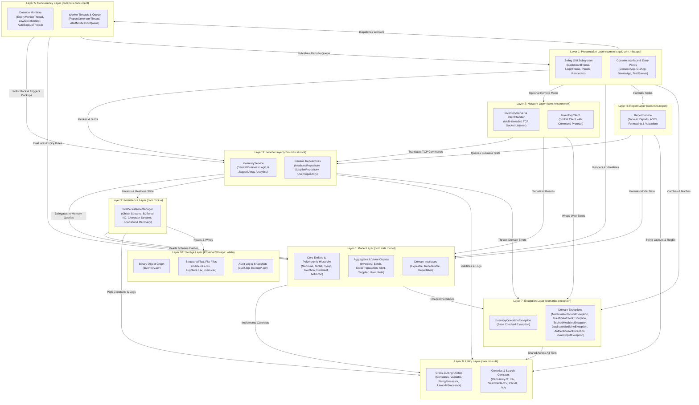
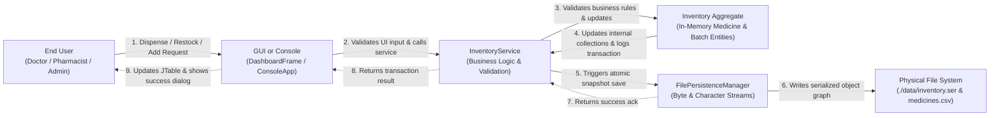

# MITS Architecture

**Intelligent Medical Inventory Tracking System (MITS)**  
*B.Tech Computer Science & Engineering (Artificial Intelligence) — Capstone Project / PBL Assessment 2*  
*Course: Object-Oriented Techniques using Java (Pure Java SE 17+)*

---

## 1. System Architectural Overview

The **Intelligent Medical Inventory Tracking System (MITS)** is engineered as a robust, decoupled, n-tier enterprise-grade desktop and client-server application. Built purely on standard Java SE libraries (without third-party dependencies such as Spring, Hibernate, or Maven/Gradle plugins), MITS enforces strict separation of concerns, high cohesion, loose coupling, and defensive programming.

The architecture comprises ten well-defined hierarchical tiers spanning user presentation, distributed socket networking, business domain services, reporting, multithreaded background monitors, entity models, custom exception hierarchies, shared generics and utilities, file stream persistence, and physical disk storage.

```
+-------------------------------------------------------------------------+
|                  1. Presentation Layer (GUI / CLI)                      |
+------------------------------------+------------------------------------+
|   2. Network Layer (Sockets)       |   4. Report Layer (Analytics)      |
+------------------------------------+------------------------------------+
|                  3. Service Layer (Business Logic)                      |
+------------------------------------+------------------------------------+
| 5. Concurrency Layer (Monitors)    |   7. Exception Layer (Taxonomy)    |
+------------------------------------+------------------------------------+
|                  6. Model Layer (Domain Entities)                       |
+------------------------------------+------------------------------------+
|                  8. Utility Layer (Generics / Strings)                  |
+------------------------------------+------------------------------------+
|                  9. Persistence Layer (Byte / Char I/O)                 |
+-------------------------------------------------------------------------+
|                 10. Storage Layer (Physical Files / Disk)               |
+-------------------------------------------------------------------------+
```

---

## 2. Layered Architecture Diagram

The following Mermaid diagram illustrates the 10 layers arranged top-to-bottom, including their package members, inter-layer boundaries, and dependency relationships.



---

## 3. Package Responsibilities & Component Breakdown

### 3.1. Layer 1: Presentation Layer (`com.mits.gui`, `com.mits.app`)

The Presentation Layer serves as the human-computer interface, offering two distinct interaction surfaces: a Swing graphical user interface (GUI) and an ANSI terminal console interface (CLI).

#### Package `com.mits.gui`
- **`DashboardFrame`**: The primary operational window using `JTabbedPane`. Hosts six functional tabs:
  1. *Dashboard*: Metric cards (`StatusCardPanel`), stock health metrics, custom AWT chart (`CategoryBarChartPanel`), and real-time alerts.
  2. *Inventory Management*: Complete tabular catalog with sorting (`TableRowSorter`), filtering, search, and CSV export.
  3. *Dispense / Restock*: Transactional dispensing with FIFO batch reduction and replenishment.
  4. *Add Medicine*: Polymorphic medicine entry forms leveraging `CardLayout` for category-specific attributes.
  5. *Reports*: Asynchronous report compilation with `JProgressBar` and ASCII export.
  6. *Remote Server*: Sockets tab interacting over TCP with remote MITS instances.
  Enforces **Role-Based Access Control (RBAC)** by programmatically disabling or hiding administrative tabs based on user role (`ADMIN`, `PHARMACIST`, `DOCTOR`).
- **`LoginFrame`**: Modal authentication window validating credentials via `InventoryService.authenticate()`.
- **`CategoryBarChartPanel`**: Custom Java 2D graphics component (`java.awt.Graphics2D`) that computes relative category frequencies, draws axes, renders color-coded bars, draws shadow effects, and displays numeric counts dynamically.
- **`StatusCardPanel`**: Reusable KPI card rendering bold counts, colored borders, and custom background highlights.
- **`MedicineTableModel`**: Concrete `AbstractTableModel` mapping in-memory `List<Medicine>` objects to Swing `JTable` rows with zero object-cloning overhead.
- **`MedicineTableCellRenderer`**: Visual highlighter highlighting low-stock rows in soft orange and expired medicine rows in soft red.

#### Package `com.mits.app`
- **`GuiApp`**: Bootstraps the GUI environment, configures the native system Look and Feel, verifies seed data, and initiates the login sequence on the Swing Event Dispatch Thread (EDT) via `SwingUtilities.invokeLater()`.
- **`ConsoleApp`**: Command-line interactive terminal with ANSI colors, formatted tables, command-line arguments (`--seed`, `--report`, `--user`, `--help`), and complete menu loops.
- **`ServerApp`**: Headless server entry point starting `InventoryServer` on port `5000` (or specified argument) for standalone background hosting.
- **`TestRunner`**: Automated standalone test execution suite containing 35 test cases validating models, algorithms, file I/O, exceptions, and socket networks without requiring third-party testing frameworks.

---

### 3.2. Layer 2: Network Layer (`com.mits.network`)

The Network Layer facilitates distributed hospital operations, allowing remote ward terminals or doctor workstations to query central pharmacy stock over TCP/IP sockets.

#### Key Components:
- **`InventoryServer`**:
  - Encapsulates a standard Java `ServerSocket` bound to a configurable TCP port (default: `5000`).
  - Employs an `ExecutorService` cached thread pool (`Executors.newCachedThreadPool()`) to handle concurrent client sessions concurrently.
  - Implements an atomic shutdown lifecycle using `AtomicBoolean running` and socket closing signals.
- **`InventoryServer.ClientHandler`**:
  - Implements `Runnable` to handle individual client socket connections.
  - Implements a textual line-based Request-Response Command Protocol:
    - `AUTH <username> <password>`: Authenticates session.
    - `GET_ALL`: Returns summary lines of all medicines.
    - `GET <medicineCode>`: Queries medicine details.
    - `SEARCH <query>`: Textual substring and category search.
    - `DISPENSE <code/id> <quantity> <reason>`: Executes stock deduction.
    - `RESTOCK <code/id> <quantity>`: Restocks existing batches.
    - `ALERTS`: Returns unacknowledged alerts.
    - `REPORT <type>`: Emits full text reports.
    - `QUIT` / `BYE`: Graceful socket disconnect.
  - Formats multi-line payloads using framing tokens (`COUNT <n>`, lines, followed by `OK END_<COMMAND>`).
- **`InventoryClient`**:
  - Socket client wrapping `Socket`, `BufferedReader`, and `PrintWriter`.
  - Implements `AutoCloseable` for reliable try-with-resources cleanup.
  - Provides thread-safe methods (`connect()`, `sendCommand()`, `disconnect()`) leveraged by both `ConsoleApp` and GUI Remote tabs.

---

### 3.3. Layer 3: Service Layer (`com.mits.service`)

The Service Layer coordinates business logic, encapsulates transactional workflows, maintains entity consistency, executes jagged array consumption analytics, and coordinates repository data access.

#### Key Components:
- **`InventoryService`**:
  - Primary service facade injected into presentation controllers and servers.
  - **Thread-Safety & Synchronization**: Protects mutation operations (`dispenseMedicine()`, `restockMedicine()`, `addMedicine()`, `removeMedicine()`) with `synchronized` locks to prevent race conditions during concurrent dispensations.
  - **Seed Data Management**: Automatically initializes 28 realistic clinical medicines, 4 suppliers, and 3 RBAC users upon first boot if disk stores are empty.
  - **Jagged Arrays (Unit 2)**: Maintains a 12-month jagged array `double[][] monthlyConsumption` where each row represents a month and columns correspond to days in that month (28 to 31 days). Computes consumption velocity, peak days, and standard deviations.
  - **Method Overloading (Unit 2)**: Exposes overloaded business methods:
    - `searchMedicine(String query)`: General query matching name, code, description, and supplier.
    - `searchMedicine(String query, String category)`: Scoped query filtering by category.
    - `searchMedicine(double minPrice, double maxPrice)`: Range search by pricing bracket.
    - `dispenseMedicine(String identifier, int quantity)`: Default dispensed reason.
    - `dispenseMedicine(String identifier, int quantity, String performedBy, String reason)`: Audited transactional dispense.
  - **Observer / Listener Alert Dispatcher**: Maintains a thread-safe `CopyOnWriteArrayList<Consumer<Alert>>` to push alerts to GUI or network subscribers.
- **`MedicineRepository`**: Generic repository subclassing `Repository<Medicine, String>` managing in-memory medicine collections.
- **`SupplierRepository`**: Generic repository subclassing `Repository<Supplier, String>` managing vendor records.
- **`UserRepository`**: Generic repository subclassing `Repository<User, String>` managing user credentials and roles.

---

### 3.4. Layer 4: Report Layer (`com.mits.report`)

The Report Layer extracts, filters, aggregates, and transforms inventory states into formatted ASCII documents.

#### Key Components:
- **`ReportService`**:
  - Decoupled from GUI rendering logic, generating pure text documents suitable for terminal printing, GUI text areas, or file exports.
  - Synthesizes comprehensive reports:
    1. *Low Stock Alert Report*: Lists items below threshold with suggested reorder quantities.
    2. *Expiry Risk & Critical Quarantine Report*: Details expired batches and near-expiry medicines (<= 30 days) with remaining day counts.
    3. *Jagged Array Consumption Report*: Tabulates day-by-day drug utilization across monthly jagged rows with min, max, and variance calculations.
    4. *Supplier Procurement & Performance Summary*: Cross-references medicines with supplier contact metadata.
    5. *Full Inventory Financial Valuation Report*: Calculates total asset value per category, holding costs, and batch breakdown.
  - Employs `StringBuilder` for O(N) string concatenation performance and tabular ASCII alignment.

---

### 3.5. Layer 5: Concurrency Layer (`com.mits.concurrent`)

The Concurrency Layer encapsulates all multithreaded processing, background polling monitors, thread synchronizations, and producer-consumer message queues.

#### Key Components:
- **`AlertNotificationQueue`**:
  - Implements the classic **Producer-Consumer Pattern** on a bounded monitor.
  - Uses `synchronized` blocks with `wait()` and `notifyAll()` to coordinate worker threads.
  - Exposes blocking `produce()`, non-blocking `offer()`, blocking `consume()`, and timed `poll(timeoutMs)`.
- **`ExpiryMonitorThread`**:
  - Extends `Thread` as a background **Daemon Thread** (`setDaemon(true)`).
  - Configured with lowered priority (`Thread.MIN_PRIORITY + 2`) to prioritize interactive UI and transactions.
  - Periodically scans inventory batches, identifying expired drugs or items within 30 days of expiry, generating `CRITICAL` or `WARNING` alerts.
- **`LowStockMonitor`**:
  - Implements the `Runnable` interface.
  - Periodically checks medicine stocks against minimum reorder points, calculating reorder quantities and queuing alerts.
- **`AutoBackupThread`**:
  - Extends `Thread` as a lowest-priority daemon (`Thread.MIN_PRIORITY`).
  - Executes automated periodic snapshot backups of the inventory binary state into `./data/backup/`.
- **`ReportGeneratorThread`**:
  - Extends `Thread` as an asynchronous worker thread.
  - Offloads computationally intensive report synthesis from the Swing Event Dispatch Thread (EDT) to avoid UI freezing.
  - Employs progress callbacks (`BiConsumer<Integer, String>`) to update `JProgressBar` components smoothly.
- **`ConcurrencyDemo`**:
  - Self-contained runnable harness executing concurrent multi-threaded stress tests, demonstrating race-condition prevention across simultaneous restocks and dispensations.

---

### 3.6. Layer 6: Model Layer (`com.mits.model`)

The Model Layer represents core domain concepts, entities, transactional records, and behavioral contracts.

```
                    +------------------------+
                    |       Medicine         | (Abstract Base Entity)
                    | (Serializable, etc.)   |
                    +-----------+------------+
                                ^
         +----------------------+----------------------+
         |                      |                      |
  +------+------+        +------+------+        +------+------+
  |   Tablet    |        |    Syrup    |        |  Injection  |
  +------+------+        +-------------+        +-------------+
         ^
         |
  +------+------+
  | Antibiotic  | (Multilevel Inheritance)
  +-------------+
```

#### Key Components:
- **`Medicine`** *(Abstract Class)*:
  - Base class implementing `Searchable<String>`, `Expirable`, `Reorderable`, `Reportable`, and `Serializable`.
  - Encapsulates common attributes: `id`, `code`, `name`, `unitPrice`, `reorderLevel`, `supplierId`, `description`, `batches` (`List<Batch>`).
  - Abstract methods enforce polymorphic specialization: `getCategory()`, `getStorageCondition()`, `getDosageFormDetails()`.
- **Inheritance Hierarchy Subclasses**:
  - **`Tablet`**: Adds `stripSize` (tablets per strip) and `isChewable`.
  - **`Antibiotic`**: Demonstrates **Multilevel Inheritance** (`Medicine -> Tablet -> Antibiotic`). Adds `spectrum` ("Broad-Spectrum" / "Narrow-Spectrum") and `requiresPrescription`.
  - **`Syrup`**: Adds `bottleVolumeMl` and `measuringCupIncluded`.
  - **`Injection`**: Adds `vialType` ("Ampoule", "Vial", "Prefilled Syringe") and `isColdChainRequired`.
  - **`Ointment`**: Adds `tubeWeightGrams` and `baseType` ("Water-soluble", "Oleaginous").
- **Supporting Aggregate Entities**:
  - **`Batch`**: Tracks batch number, available quantity, manufacturing date, and expiry date. Implements FIFO batch consumption.
  - **`StockTransaction`**: Immutable historical audit entry tracking `DISPENSE`, `RESTOCK`, or `ADJUSTMENT`, timestamps, user IDs, and notes.
  - **`Inventory`**: Aggregate root holding collections of `Medicine` and `StockTransaction`. Serialized as the primary state graph.
  - **`Supplier`**: Represents pharmaceutical manufacturers and distributors.
  - **`User`**: System account entity with hashed passwords and associated `Role`.
  - **`Role`**: Enum defining security authorization (`ADMIN`, `PHARMACIST`, `DOCTOR`).
  - **`Alert`**: Event record containing alert ID, type (`LOW_STOCK`, `NEAR_EXPIRY`, `EXPIRED`), severity, and message.
- **Domain Interfaces**:
  - **`Expirable`**: Defines contract for expiry date tracking, `isExpired()`, and `daysToExpiry()`.
  - **`Reorderable`**: Defines contract for stock deficit checking, `needsReorder()`, and `reorderQuantity()`.
  - **`Reportable`**: Defines contract for generating formatted summary strings and ASCII line representations.

---

### 3.7. Layer 7: Exception Layer (`com.mits.exception`)

The Exception Layer provides a domain-specific exception taxonomy, enforcing safe error boundaries, descriptive messaging, and clean error propagation.

#### Exception Taxonomy:
```
java.lang.Throwable
 └── java.lang.Exception
      └── InventoryOperationException (Root Domain Checked Exception)
           ├── MedicineNotFoundException
           ├── InsufficientStockException
           ├── ExpiredMedicineException
           ├── DuplicateMedicineException
           ├── AuthenticationException
           └── InvalidInputException (Unchecked / Runtime Validation Exception)
```

#### Key Components:
- **`InventoryOperationException`**: Abstract or root checked exception containing operational context and failed entity codes.
- **`MedicineNotFoundException`**: Thrown when lookups fail for a specified SKU or identifier.
- **`InsufficientStockException`**: Thrown when a dispense request exceeds available stock; carries requested quantity vs. available balance.
- **`ExpiredMedicineException`**: Thrown when an attempt is made to dispense stock from expired batches, enforcing safety quarantine.
- **`DuplicateMedicineException`**: Thrown during inventory addition if an SKU code already exists.
- **`AuthenticationException`**: Thrown when credential verification fails or an unauthorized user attempts a privileged action.
- **`InvalidInputException`**: Unchecked `RuntimeException` thrown when input validation fails (e.g. negative prices, malformed dates).
- **`ExceptionDemo`**: Standalone educational demonstrator illustrating checked vs. unchecked exceptions, try-catch-finally, try-with-resources, re-throwing, and chained root causes.

---

### 3.8. Layer 8: Utility Layer (`com.mits.util`)

The Utility Layer supplies generic types, lambda functional processors, string manipulation routines, regex validation, and system constants across all layers.

#### Key Components:
- **`Constants`**: Global application constants defining directory locations (`data/`, `data/backup/`), file paths, network ports, and application metadata.
- **`Validator`**: Input validation routines using Regular Expressions (`Pattern`, `Matcher`) for email formats, Indian phone numbers, medicine SKU codes, dates, and non-empty strings.
- **`StringProcessor`**: Text manipulation routines utilizing `String`, `StringBuilder`, `StringBuffer` (for thread-safe audit logging), string tokenization, padding, and date formatting.
- **`LambdaProcessor`**: Functional programming helper utilizing standard Java functional interfaces:
  - `Predicate<T>`: Filtering collections (e.g. expired medicines, low-stock items).
  - `Function<T, R>`: Transforming entities into display summaries.
  - `Consumer<T>`: Iterating and executing batch operations.
  - `Comparator<T>`: Dynamic multi-field sorting by name, price, stock, or expiry.
- **`Repository<T, ID>`**: Generic repository interface defining CRUD operations (`add`, `getById`, `getAll`, `update`, `delete`, `size`, `exists`).
- **`Searchable<T>`**: Generic interface enforcing search contracts across domain models.
- **`Pair<K, V>`**: Generic container storing paired key-value records.

---

### 3.9. Layer 9: Persistence Layer (`com.mits.io`)

The Persistence Layer handles persistent storage operations, bridging in-memory object graphs and physical files using Java Byte Streams and Character Streams.

#### Key Components:
- **`FilePersistenceManager`**:
  - **Byte Streams (Serialization)**:
    - Writes graph state via `FileOutputStream -> BufferedOutputStream -> ObjectOutputStream`.
    - Restores graph state via `FileInputStream -> BufferedInputStream -> ObjectInputStream`.
    - Handles file corruption gracefully by falling back to the latest valid backup snapshot.
  - **Character Streams (CSV & Plain Text)**:
    - Exports and imports catalog data via `FileWriter -> BufferedWriter -> PrintWriter` and `FileReader -> BufferedReader`.
    - Generates clean, parseable CSV records with field escaping.
  - **Backup & Disaster Recovery**:
    - Creates timestamped snapshot files (`backup/inventory_backup_YYYYMMDD_HHMMSS.ser`).
    - Maintains backup rotation and automated restoration workflows.
  - **Thread-Safe File Access**: Uses `synchronized` methods to prevent interleaved write operations from background auto-backup threads and user actions.

---

### 3.10. Layer 10: Storage Layer (`./data`)

The Storage Layer represents the local disk filesystem hosting application data files:

#### Directory Structure:
```
data/
├── inventory.ser                     # Binary serialized Java object graph (Inventory aggregate)
├── medicines.csv                     # Comma-Separated Values text export of medicine records
├── suppliers.csv                     # Flat-file backup of supplier directory
├── users.csv                         # Flat-file backup of user accounts and role definitions
├── audit.log                         # Continuous human-readable append-only activity log
└── backup/                           # Disaster recovery directory
    ├── inventory_backup_20261008_120000.ser
    └── inventory_backup_20261008_130000.ser
```

---

## 4. System Data Flow Architecture

The MITS system processes data across two primary pipelines:
1. **Synchronous Transactional & Persistence Data Flow**: User-driven operations flowing downward through services to physical storage.
2. **Asynchronous Reactive Monitoring & Alert Dispatch Flow**: Background daemon threads evaluating thresholds and pushing alerts upward into the GUI queue.

---

### 4.1. Transactional & Persistence Data Flow



#### Detailed Transaction Lifecycle:
1. **User Action**: The user selects a medicine on the GUI `Dispense / Restock` tab, enters a quantity and reason, and clicks **Dispense Medicine**.
2. **Input Validation**: The GUI validates that quantity is a positive integer using `Validator.isValidNumber()`.
3. **Service Invocation**: GUI invokes `inventoryService.dispenseMedicine(code, qty, user, reason)`.
4. **Business Rule Enforcement**:
   - Acquires the `synchronized` lock on `InventoryService`.
   - Checks if the medicine exists; otherwise throws `MedicineNotFoundException`.
   - Validates that total available non-expired stock >= requested quantity; otherwise throws `InsufficientStockException`.
   - Checks expiry dates on available batches; expired batches throw `ExpiredMedicineException`.
5. **Entity Modification**:
   - Deducts stock from batches in **FIFO (First-In, First-Out)** order based on expiry date.
   - Appends an immutable `StockTransaction` record to the inventory's audit history.
6. **Persistence Serialization**:
   - `InventoryService` calls `persistenceManager.saveInventoryBinary(inventory, Constants.INVENTORY_SER_FILE)`.
   - Serializes the entire object graph to `./data/inventory.ser`.
   - Appends a log line to `./data/audit.log` via `StringProcessor.logActivity()`.
7. **View Refresh**: `InventoryService` completes; the GUI receives control, re-queries the table model, triggers `fireTableDataChanged()`, and notifies the user with a confirmation dialog.

---

### 4.2. Asynchronous Monitoring & Alert Notification Flow

```mermaid
flowchart TD
    subgraph Threads["Background Daemon Threads"]
        EXP["ExpiryMonitorThread<br/>(Daemon, Priority: 3)"]
        LOW["LowStockMonitor<br/>(Runnable Worker)"]
        BACKUP["AutoBackupThread<br/>(Daemon, Priority: 1)"]
    end

    subgraph ServiceLayer["Service Orchestration"]
        SVC["InventoryService<br/>(Thread-Safe Queries & Dispatcher)"]
    end

    subgraph QueueLayer["Producer-Consumer Bounded Queue"]
        QUEUE["AlertNotificationQueue<br/>(Thread-safe monitor with wait/notifyAll)"]
    end

    subgraph Presentation["Presentation & Observer Listeners"]
        EDT["Swing Event Dispatch Thread<br/>(SwingUtilities.invokeLater)"]
        GUI_VIEW["DashboardFrame Alerts Area<br/>& Metric Cards"]
    end

    EXP -->|1. Scans batches periodically| SVC
    LOW -->|1. Scans stock levels periodically| SVC
    BACKUP -->|Triggers auto-backup snapshot| SVC

    SVC -->|2. Identifies threshold breaches| EXP
    SVC -->|2. Identifies threshold breaches| LOW

    EXP -->|3. Produces Alert via produce()| QUEUE
    LOW -->|3. Produces Alert via produce()| QUEUE

    QUEUE -->|4. Consumer thread polls alert| EDT
    SVC -->|4. Alternate: push callback listener| EDT

    EDT -->|5. Schedules UI update on Event Queue| GUI_VIEW
```

#### Detailed Reactive Monitoring Lifecycle:
1. **Periodic Background Execution**:
   - `ExpiryMonitorThread` wakes every $N$ seconds (configured interval) and executes `scanForExpiryRisks()`.
   - `LowStockMonitor` wakes periodically and executes `scanLowStock()`.
2. **Threshold Inspection**:
   - The monitors read the current inventory state via `inventoryService.getAllMedicines()`.
   - For every medicine, `m.needsReorder()` evaluates if `totalStock <= reorderLevel`.
   - `m.isExpired()` and `m.daysToExpiry() <= 30` evaluate expiry risk.
3. **Alert Production**:
   - If a risk condition is detected, an `Alert` object is instantiated with severity (`CRITICAL`, `WARNING`, `INFO`).
   - The monitor calls `alertQueue.produce(alert)` (or non-blocking `offer(alert)`). If the bounded queue is full, the thread suspends via `wait()` until space is made available.
4. **Queue Notification & Observer Dispatch**:
   - Upon adding the alert, `notifyAll()` wakes any waiting consumers.
   - Concurrently, `inventoryService.dispatchAlert(alert)` notifies registered observers (`Consumer<Alert>`).
5. **Thread Transition to Swing EDT**:
   - Background threads cannot directly modify Swing UI components without violating Swing's single-thread rule.
   - The listener invokes `SwingUtilities.invokeLater(() -> alertsArea.append(alert.toString()))`.
   - The UI updates safely on the Event Dispatch Thread (EDT), flashing alert badges and playing warning sounds if critical.

---

## 5. Cross-Cutting Architectural Patterns & Concerns

### 5.1. Concurrency and Thread Safety
- **Intrinsic Monitor Synchronization**: All shared mutable state in `InventoryService`, `FilePersistenceManager`, and `AlertNotificationQueue` is guarded using Java `synchronized` methods and blocks.
- **Producer-Consumer Coordination**: `AlertNotificationQueue` implements explicit monitor locking using `wait()` when the queue is full/empty and `notifyAll()` upon enqueue/dequeue.
- **Daemon Thread Management**: Maintenance threads (`ExpiryMonitorThread`, `AutoBackupThread`) are configured as daemon threads (`setDaemon(true)`), ensuring they automatically terminate when the main application window or console loop exits.
- **Thread Prioritization**: Low-impact maintenance tasks run at `Thread.MIN_PRIORITY`, monitoring tasks run at low priority (`MIN_PRIORITY + 2`), leaving CPU headroom for interactive UI and transaction processing.
- **Asynchronous UI Decoupling**: Heavy tasks such as statistical report synthesis are wrapped in `ReportGeneratorThread`, notifying the UI via `SwingUtilities.invokeLater` callbacks to prevent freezing the interface.

### 5.2. Persistence & Disaster Recovery Strategy
- **Dual Persistence Channels**: 
  - *Binary Serialization*: Serializes complete in-memory object graphs (including batch graphs and transaction lists) into `inventory.ser` using `ObjectOutputStream`.
  - *Human-Readable Character Exports*: Generates standard CSV files (`medicines.csv`, `suppliers.csv`, `users.csv`) using `PrintWriter` and `BufferedWriter` for interoperability with external spreadsheet tools.
- **Automated Backup Rotation**: `AutoBackupThread` writes timestamped backups into `data/backup/` at configurable intervals.
- **Corrupted State Graceful Recovery**: `FilePersistenceManager` catches deserialization exceptions, empty file issues, or `InvalidClassException` errors, automatically falling back to the latest valid timestamped backup file before generating default seed data.

### 5.3. Design Patterns Summary
| Design Pattern | Implementation Class(es) | Architectural Purpose |
|---|---|---|
| **Repository Pattern** | `Repository<T, ID>`, `MedicineRepository`, `SupplierRepository`, `UserRepository` | Decouples business logic from low-level data storage and retrieval. |
| **Producer-Consumer** | `AlertNotificationQueue`, `ExpiryMonitorThread`, `LowStockMonitor` | Decouples asynchronous alert production from consumption and presentation. |
| **Observer / Callback** | `InventoryService.alertListeners`, `Consumer<Alert>` | Pushes alert notifications to registered UI listeners without tight coupling. |
| **Template Method / Inheritance** | `Medicine` (abstract base), `Tablet`, `Syrup`, `Injection`, `Ointment`, `Antibiotic` | Enforces shared medicine lifecycle while allowing custom dosage, storage, and packaging specialization. |
| **Card Layout Pattern** | `DashboardFrame.specificFieldsPanel` | Swaps form input panels dynamically based on selected medicine category. |
| **Command Protocol** | `InventoryServer.ClientHandler`, `InventoryClient` | Encapsulates client requests into a line-oriented socket command protocol. |
| **Singleton-like Constants** | `Constants` | Centralizes immutable application-wide configuration values. |
| **Custom Renderer Pattern** | `MedicineTableCellRenderer` | Decouples data models from visual table styling (e.g. low-stock highlighting). |

---

## 6. Syllabus & Curriculum Mapping

The architecture maps to all five units of the **Object-Oriented Techniques using Java** course syllabus:

| Unit | Syllabus Topics Covered | Architecture Component / Class |
|---|---|---|
| **Unit 1** | OOP Fundamentals, Classes, Objects, Constructors, Encapsulation | `Medicine`, `Batch`, `Supplier`, `User`, `StockTransaction` |
| **Unit 2** | Inheritance, Polymorphism, Abstract Classes, Method Overriding & Overloading, Jagged Arrays | `Medicine` hierarchy (`Tablet`, `Syrup`, `Injection`, `Ointment`, `Antibiotic`), `InventoryService` jagged array consumption matrices and overloaded search methods |
| **Unit 3** | Generic Classes & Interfaces, Collections Framework, Lambda Expressions, String Handling | `Repository<T, ID>`, `Pair<K, V>`, `Searchable<T>`, `LambdaProcessor`, `StringProcessor`, `Validator`, `List`, `Map`, `Queue` |
| **Unit 4** | File I/O (Byte & Character Streams), Multithreading, Thread Synchronization, Socket Programming | `FilePersistenceManager`, `AlertNotificationQueue`, `ExpiryMonitorThread`, `LowStockMonitor`, `AutoBackupThread`, `InventoryServer`, `InventoryClient` |
| **Unit 5** | Swing GUI Components, Layout Managers, Event Handling, AWT Graphics & Painting | `DashboardFrame`, `LoginFrame`, `CategoryBarChartPanel`, `StatusCardPanel`, `MedicineTableModel`, `MedicineTableCellRenderer` |

---

*Document generated for MITS B.Tech CSE-AI Capstone Project PBL Assessment 2.*
