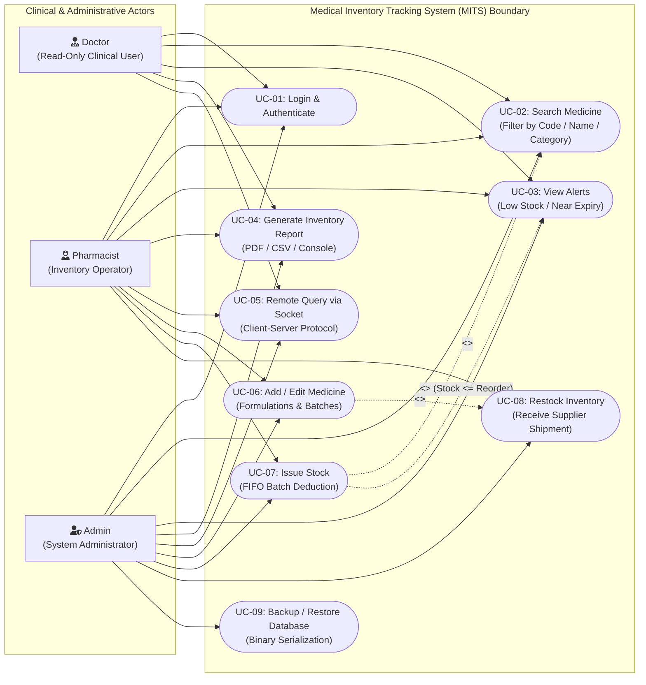
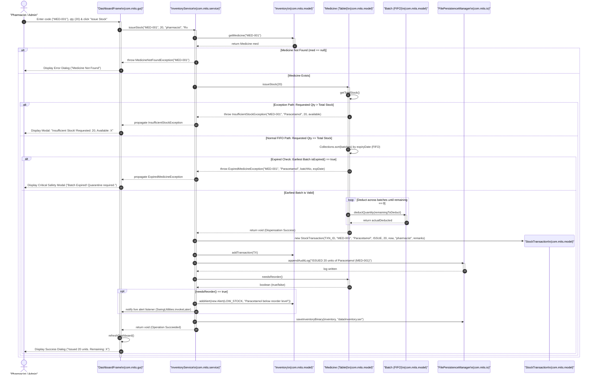
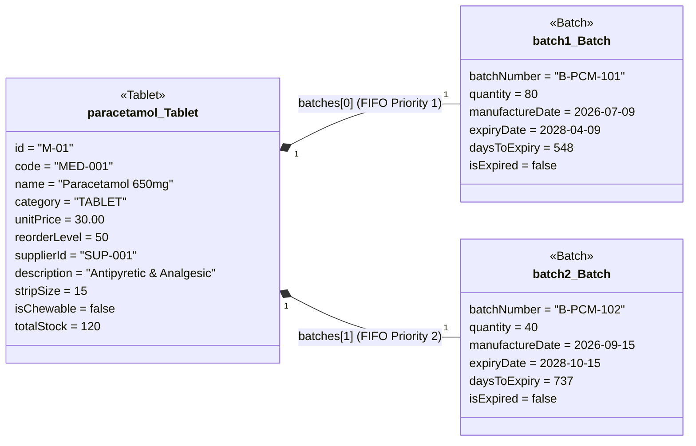

# Unified Modeling Language (UML) Design Documentation
## Intelligent Medical Inventory Tracking System (MITS)
**Course:** B.Tech Computer Science & Engineering (Artificial Intelligence)  
**Curriculum Module:** Capstone Project-Based Learning (PBL) Assessment 2  
**Base Package:** `com.mits`  
**Target Specification:** Model, Behavioral, Structural, and Instance Architecture  

---

## Table of Contents
1. [Executive Architectural Summary](#1-executive-architectural-summary)
2. [Class Diagram (Structural Architecture)](#2-class-diagram-structural-architecture)
   - [Mermaid Class Diagram](#21-mermaid-class-diagram)
   - [Object-Oriented Design Pillars in MITS](#22-object-oriented-design-pillars-in-mits)
   - [Structural Relationships & Multiplicity Specifications](#23-structural-relationships--multiplicity-specifications)
   - [Class & Interface Detailed Specifications](#24-class--interface-detailed-specifications)
3. [Use Case Diagram (Functional & Behavioral Requirements)](#3-use-case-diagram-functional--behavioral-requirements)
   - [Mermaid Use Case Diagram](#31-mermaid-use-case-diagram)
   - [Actor Profiles & Security Privileges](#32-actor-profiles--security-privileges)
   - [Use Case Specifications](#33-use-case-specifications)
   - [Role-Based Access Control (RBAC) Matrix](#34-role-based-access-control-rbac-matrix)
4. [Sequence Diagram: 'Issue Stock' Workflow](#4-sequence-diagram-issue-stock-workflow)
   - [Mermaid Sequence Diagram](#41-mermaid-sequence-diagram)
   - [Step-by-Step Message Flow & Execution Logic](#42-step-by-step-message-flow--execution-logic)
   - [Exception Handling Paths](#43-exception-handling-paths)
   - [Concurrency & Synchronization Invariants](#44-concurrency--synchronization-invariants)
5. [Object Diagram: Runtime Instance Snapshot](#5-object-diagram-runtime-instance-snapshot)
   - [Mermaid Object Diagram](#51-mermaid-object-diagram)
   - [Detailed Runtime State Analysis](#52-detailed-runtime-state-analysis)
   - [FIFO Inventory Verification](#53-fifo-inventory-verification)
6. [Design Patterns & Architectural Mapping](#6-design-patterns--architectural-mapping)
7. [Traceability Matrix: UML Elements to Source Code](#7-traceability-matrix-uml-elements-to-source-code)

---

## 1. Executive Architectural Summary

The **Intelligent Medical Inventory Tracking System (MITS)** is an enterprise-grade pharmaceutical inventory and dispensing control management platform engineered using standard **Object-Oriented Programming (OOP)** paradigms in Java. MITS enforces strict statutory compliance, patient safety guidelines, First-In, First-Out (FIFO) stock dispensing, cold-chain regulatory monitoring, and real-time inventory analytics.

This document formalizes the complete software architecture of MITS through four complementary UML models:
1. **Class Diagram:** Captures the structural schema of the domain model (`com.mits.model`), illustrating inheritance hierarchies (single and multilevel), abstract contracts, interface realizations, composition, aggregation, and associations.
2. **Use Case Diagram:** Models system functional scope across clinical and administrative personas (`Admin`, `Pharmacist`, `Doctor`), delineating security boundaries.
3. **Sequence Diagram:** Visualizes the dynamic collaboration and message-passing sequence for the mission-critical **Issue Stock** transaction, including optimistic FIFO deduction and checked exception escalation (`InsufficientStockException`, `ExpiredMedicineException`).
4. **Object Diagram:** Provides a deterministic runtime memory snapshot of a concrete medicine instance (`Tablet`) bound to multiple manufacturing batch instances (`Batch`), verifying data integrity and inventory invariants.

---

## 2. Class Diagram (Structural Architecture)

The core domain model is encapsulated within the [`com.mits.model`](file:///c:/Users/devis/Downloads/java/src/com/mits/model) package. It employs an abstract base class [`Medicine`](file:///c:/Users/devis/Downloads/java/src/com/mits/model/Medicine.java), three domain interfaces ([`Expirable`](file:///c:/Users/devis/Downloads/java/src/com/mits/model/Expirable.java), [`Reorderable`](file:///c:/Users/devis/Downloads/java/src/com/mits/model/Reorderable.java), [`Reportable`](file:///c:/Users/devis/Downloads/java/src/com/mits/model/Reportable.java)), five concrete product classes ([`Tablet`](file:///c:/Users/devis/Downloads/java/src/com/mits/model/Tablet.java), [`Antibiotic`](file:///c:/Users/devis/Downloads/java/src/com/mits/model/Antibiotic.java), [`Syrup`](file:///c:/Users/devis/Downloads/java/src/com/mits/model/Syrup.java), [`Injection`](file:///c:/Users/devis/Downloads/java/src/com/mits/model/Injection.java), [`Ointment`](file:///c:/Users/devis/Downloads/java/src/com/mits/model/Ointment.java)), composite manufacturing batches ([`Batch`](file:///c:/Users/devis/Downloads/java/src/com/mits/model/Batch.java)), an aggregate container ([`Inventory`](file:///c:/Users/devis/Downloads/java/src/com/mits/model/Inventory.java)), audit/alert tracking ([`StockTransaction`](file:///c:/Users/devis/Downloads/java/src/com/mits/model/StockTransaction.java), [`Alert`](file:///c:/Users/devis/Downloads/java/src/com/mits/model/Alert.java)), distributor metadata ([`Supplier`](file:///c:/Users/devis/Downloads/java/src/com/mits/model/Supplier.java)), and authentication models ([`User`](file:///c:/Users/devis/Downloads/java/src/com/mits/model/User.java), [`Role`](file:///c:/Users/devis/Downloads/java/src/com/mits/model/Role.java)).

### 2.1 Mermaid Class Diagram

```mermaid
classDiagram
    direction TB

    %% ====================================================
    %% INTERFACES
    %% ====================================================
    class Expirable {
        <<interface>>
        +isExpired() boolean
        +daysToExpiry() long
        +getExpiryDate() LocalDate
    }

    class Reorderable {
        <<interface>>
        +needsReorder() boolean
        +reorderQuantity() int
    }

    class Reportable {
        <<interface>>
        +generateSummary() String
    }

    %% ====================================================
    %% ABSTRACT BASE CLASS
    %% ====================================================
    class Medicine {
        <<abstract>>
        #String id
        #String code
        #String name
        #String category
        #double unitPrice
        #int reorderLevel
        #String supplierId
        #String description
        #List~Batch~ batches
        +Medicine()
        +Medicine(String id, String code, String name, String category, double unitPrice, int reorderLevel, String supplierId, String description)
        +getStorageCondition()* String
        +calculateDiscountedPrice(int quantity)* double
        +getDosageFormDetails()* String
        +addStock(int quantity) void
        +addStock(int quantity, LocalDate expiryDate) void
        +addStock(int quantity, Batch batch) void
        +issueStock(int quantity) void
        +getTotalStock() int
        +addBatch(Batch batch) void
        +getBatches() List~Batch~
        +setBatches(List~Batch~ batches) void
        +isExpired() boolean
        +daysToExpiry() long
        +getExpiryDate() LocalDate
        +needsReorder() boolean
        +reorderQuantity() int
        +generateSummary() String
        +compareTo(Medicine other) int
    }

    %% ====================================================
    %% CONCRETE MEDICINE SPECIALIZATIONS
    %% ====================================================
    class Tablet {
        -int stripSize
        -boolean isChewable
        +Tablet()
        +Tablet(String id, String code, String name, double unitPrice, int reorderLevel, String supplierId, String description, int stripSize, boolean isChewable)
        +getStripSize() int
        +setStripSize(int stripSize) void
        +isChewable() boolean
        +setChewable(boolean isChewable) void
        +getStorageCondition() String
        +calculateDiscountedPrice(int quantity) double
        +getDosageFormDetails() String
    }

    class Antibiotic {
        -String spectrum
        -boolean requiresPrescription
        +Antibiotic()
        +Antibiotic(String id, String code, String name, double unitPrice, int reorderLevel, String supplierId, String description, int stripSize, boolean isChewable, String spectrum, boolean requiresPrescription)
        +getSpectrum() String
        +setSpectrum(String spectrum) void
        +isRequiresPrescription() boolean
        +setRequiresPrescription(boolean req) void
        +getStorageCondition() String
        +calculateDiscountedPrice(int quantity) double
        +getDosageFormDetails() String
    }

    class Syrup {
        -int bottleVolumeMl
        -boolean dosageMeasuringCupIncluded
        +Syrup()
        +Syrup(String id, String code, String name, double unitPrice, int reorderLevel, String supplierId, String description, int bottleVolumeMl, boolean dosageMeasuringCupIncluded)
        +getBottleVolumeMl() int
        +setBottleVolumeMl(int bottleVolumeMl) void
        +isDosageMeasuringCupIncluded() boolean
        +setDosageMeasuringCupIncluded(boolean cup) void
        +getStorageCondition() String
        +calculateDiscountedPrice(int quantity) double
        +getDosageFormDetails() String
    }

    class Injection {
        -String vialType
        -boolean isColdChainRequired
        +Injection()
        +Injection(String id, String code, String name, double unitPrice, int reorderLevel, String supplierId, String description, String vialType, boolean isColdChainRequired)
        +getVialType() String
        +setVialType(String vialType) void
        +isColdChainRequired() boolean
        +setColdChainRequired(boolean cold) void
        +getStorageCondition() String
        +calculateDiscountedPrice(int quantity) double
        +getDosageFormDetails() String
    }

    class Ointment {
        -double tubeWeightGrams
        -String baseType
        +Ointment()
        +Ointment(String id, String code, String name, double unitPrice, int reorderLevel, String supplierId, String description, double tubeWeightGrams, String baseType)
        +getTubeWeightGrams() double
        +setTubeWeightGrams(double wt) void
        +getBaseType() String
        +setBaseType(String baseType) void
        +getStorageCondition() String
        +calculateDiscountedPrice(int quantity) double
        +getDosageFormDetails() String
    }

    %% ====================================================
    %% COMPOSITION & ASSOCIATION MODELS
    %% ====================================================
    class Batch {
        -String batchNumber
        -int quantity
        -LocalDate manufactureDate
        -LocalDate expiryDate
        +Batch()
        +Batch(String batchNumber, int quantity, LocalDate manufactureDate, LocalDate expiryDate)
        +getBatchNumber() String
        +setBatchNumber(String batchNumber) void
        +getQuantity() int
        +setQuantity(int quantity) void
        +getManufactureDate() LocalDate
        +setManufactureDate(LocalDate mfgDate) void
        +getExpiryDate() LocalDate
        +setExpiryDate(LocalDate expDate) void
        +deductQuantity(int amount) int
        +addQuantity(int amount) void
        +isExpired() boolean
        +daysToExpiry() long
        +compareTo(Batch other) int
    }

    class Supplier {
        -String id
        -String name
        -String contactPerson
        -String phone
        -String email
        -String address
        +Supplier()
        +Supplier(String id, String name, String contactPerson, String phone, String email, String address)
        +getId() String
        +getName() String
        +getContactPerson() String
        +getPhone() String
        +getEmail() String
        +getAddress() String
    }

    class Inventory {
        -Map~String, Medicine~ medicineMap
        -List~StockTransaction~ transactions
        -LinkedList~Alert~ alertHistory
        -Set~String~ categories
        +Inventory()
        +addMedicine(Medicine medicine) void
        +getMedicine(String code) Medicine
        +containsMedicine(String code) boolean
        +removeMedicine(String code) Medicine
        +getAllMedicines() List~Medicine~
        +getMedicineCount() int
        +addTransaction(StockTransaction tx) void
        +getTransactions() List~StockTransaction~
        +addAlert(Alert alert) void
        +getAlertHistory() LinkedList~Alert~
        +getCategories() Set~String~
    }

    %% ====================================================
    %% SECURITY & AUDIT MODELS
    %% ====================================================
    class User {
        -String username
        -String password
        -String fullName
        -Role role
        +User()
        +User(String username, String password, String fullName, Role role)
        +getUsername() String
        +getFullName() String
        +getRole() Role
        +canManageStock() boolean
        +isAdmin() boolean
    }

    class Role {
        <<enumeration>>
        ADMIN
        PHARMACIST
        DOCTOR
        +getDescription() String
    }

    class Alert {
        -String alertId
        -String medicineCode
        -String medicineName
        -Type type
        -Severity severity
        -String message
        -LocalDateTime timestamp
        +Alert()
        +Alert(String id, String code, String name, Type type, Severity severity, String msg, LocalDateTime ts)
        +getAlertId() String
        +getMedicineCode() String
        +getMessage() String
        +getType() Type
        +getSeverity() Severity
        +getTimestamp() LocalDateTime
    }

    class StockTransaction {
        -String transactionId
        -String medicineCode
        -String medicineName
        -Type type
        -int quantity
        -LocalDateTime timestamp
        -String performedBy
        -String remarks
        +StockTransaction()
        +StockTransaction(String id, String code, String name, Type type, int qty, LocalDateTime ts, String user, String remarks)
        +getTransactionId() String
        +getMedicineCode() String
        +getQuantity() int
        +getType() Type
        +getPerformedBy() String
    }

    %% ====================================================
    %% RELATIONSHIPS & MULTIPLICITIES
    %% ====================================================
    Expirable <|.. Medicine : implements
    Reorderable <|.. Medicine : implements
    Reportable <|.. Medicine : implements
    Expirable <|.. Batch : implements

    Medicine <|-- Tablet : generalization
    Medicine <|-- Syrup : generalization
    Medicine <|-- Injection : generalization
    Medicine <|-- Ointment : generalization
    Tablet <|-- Antibiotic : multilevel generalization

    Medicine "1" *-- "0..*" Batch : Composition (batches)
    Medicine "0..*" --> "1" Supplier : Association (supplierId)
    Inventory "1" o-- "0..*" Medicine : Aggregation (medicineMap)

    Inventory "1" --> "0..*" StockTransaction : aggregates audit trail
    Inventory "1" --> "0..*" Alert : tracks alert history
    User "0..*" --> "1" Role : assigned authorization
```



---

### 2.2 Object-Oriented Design Pillars in MITS

The MITS class architecture serves as a reference implementation of the four foundational pillars of Object-Oriented Programming (OOP) and advanced design principles:

#### 1. Encapsulation
- All state variables in [`Batch`](file:///c:/Users/devis/Downloads/java/src/com/mits/model/Batch.java#L18-L22), [`Supplier`](file:///c:/Users/devis/Downloads/java/src/com/mits/model/Supplier.java#L15-L20), [`User`](file:///c:/Users/devis/Downloads/java/src/com/mits/model/User.java#L13-L16), [`StockTransaction`](file:///c:/Users/devis/Downloads/java/src/com/mits/model/StockTransaction.java#L22-L29), and [`Alert`](file:///c:/Users/devis/Downloads/java/src/com/mits/model/Alert.java#L27-L33) are declared `private`.
- In [`Medicine`](file:///c:/Users/devis/Downloads/java/src/com/mits/model/Medicine.java#L26-L36), state fields are scoped as `protected` to enable direct polymorphic access within specialized subclasses while strictly preventing unauthorized mutation from outside packages.
- Access is gated via defensive accessors (`getters`) and validated mutators (`setters`), enforcing bounds such as `unitPrice = Math.max(0.0, unitPrice)` and `reorderLevel = Math.max(0, reorderLevel)`.
- Immutability of sensitive collection references is maintained: `getBatches()` returns `new ArrayList<>(batches)` to protect against external mutation.

#### 2. Inheritance (Single & Multilevel)
- **Single Inheritance (Hierarchical Generalization):** Common attributes (`id`, `code`, `name`, `unitPrice`, `batches`, `reorderLevel`) are consolidated in the abstract parent [`Medicine`](file:///c:/Users/devis/Downloads/java/src/com/mits/model/Medicine.java). Concrete specializations ([`Tablet`](file:///c:/Users/devis/Downloads/java/src/com/mits/model/Tablet.java), [`Syrup`](file:///c:/Users/devis/Downloads/java/src/com/mits/model/Syrup.java), [`Injection`](file:///c:/Users/devis/Downloads/java/src/com/mits/model/Injection.java), [`Ointment`](file:///c:/Users/devis/Downloads/java/src/com/mits/model/Ointment.java)) inherit standard inventory behaviors without duplication.
- **Multilevel Inheritance:** [`Antibiotic`](file:///c:/Users/devis/Downloads/java/src/com/mits/model/Antibiotic.java) extends [`Tablet`](file:///c:/Users/devis/Downloads/java/src/com/mits/model/Tablet.java), which in turn extends [`Medicine`](file:///c:/Users/devis/Downloads/java/src/com/mits/model/Medicine.java). This models domain taxonomy: an antibiotic is a specialized form of tablet with distinct clinical attributes (`spectrum`, `requiresPrescription`) and custom pricing/storage rules.

#### 3. Polymorphism (Static Overloading & Dynamic Overriding)
- **Compile-Time Polymorphism (Method Overloading):** [`Medicine`](file:///c:/Users/devis/Downloads/java/src/com/mits/model/Medicine.java#L132-L170) provides three overloaded signatures for `addStock`:
  1. `addStock(int quantity)`: Defaults to a 1-year shelf life.
  2. `addStock(int quantity, LocalDate expiryDate)`: Creates a transient batch with custom expiration.
  3. `addStock(int quantity, Batch batch)`: Registers an explicit production batch instance with complete metadata.
- **Runtime Polymorphism (Method Overriding):** All concrete subclasses override the abstract methods:
  - `getStorageCondition()`: [`Injection`](file:///c:/Users/devis/Downloads/java/src/com/mits/model/Injection.java) specifies cold chain (2°C - 8°C); [`Tablet`](file:///c:/Users/devis/Downloads/java/src/com/mits/model/Tablet.java) specifies room temperature below 25°C.
  - `calculateDiscountedPrice(int quantity)`: Subclasses implement category-specific pricing tiers (e.g., [`Tablet`](file:///c:/Users/devis/Downloads/java/src/com/mits/model/Tablet.java) offers 5% off for 100+ units, 10% for 500+ units; [`Antibiotic`](file:///c:/Users/devis/Downloads/java/src/com/mits/model/Antibiotic.java) implements capped 4% discount).
  - `getDosageFormDetails()`: Discloses packaging forms (`stripSize`, `bottleVolumeMl`, `vialType`, `tubeWeightGrams`).

#### 4. Abstraction & Interface Segregation
- The system decouples capability from implementation via cohesive interfaces:
  - [`Expirable`](file:///c:/Users/devis/Downloads/java/src/com/mits/model/Expirable.java): Enforces expiration queries across both high-level products ([`Medicine`](file:///c:/Users/devis/Downloads/java/src/com/mits/model/Medicine.java)) and low-level physical containers ([`Batch`](file:///c:/Users/devis/Downloads/java/src/com/mits/model/Batch.java)).
  - [`Reorderable`](file:///c:/Users/devis/Downloads/java/src/com/mits/model/Reorderable.java): Decouples replenishment logic (`needsReorder`, `reorderQuantity`) from user interface controllers.
  - [`Reportable`](file:///c:/Users/devis/Downloads/java/src/com/mits/model/Reportable.java): Standardizes formatted inventory line item generation.

---

### 2.3 Structural Relationships & Multiplicity Specifications

| Relationship Type | UML Notation | Source Class | Target Class | Multiplicity | Architectural Rationale & Implementation Details |
| :--- | :---: | :--- | :--- | :---: | :--- |
| **Composition** | `*--` | [`Medicine`](file:///c:/Users/devis/Downloads/java/src/com/mits/model/Medicine.java) | [`Batch`](file:///c:/Users/devis/Downloads/java/src/com/mits/model/Batch.java) | `1` to `0..*` | Strong ownership (Part-Whole). A `Batch` has no independent clinical existence outside its parent `Medicine`. If a medicine is deleted, its batches are cascaded and destroyed. Represented by `List<Batch> batches` inside `Medicine`. |
| **Aggregation** | `o--` | [`Inventory`](file:///c:/Users/devis/Downloads/java/src/com/mits/model/Inventory.java) | [`Medicine`](file:///c:/Users/devis/Downloads/java/src/com/mits/model/Medicine.java) | `1` to `0..*` | Weak ownership (Container-Content). `Inventory` holds references to `Medicine` objects in a `Map<String, Medicine>`. If the `Inventory` is cleared or rebuilt, the medicines can still exist in backups or serialized representations. |
| **Association** | `-->` | [`Medicine`](file:///c:/Users/devis/Downloads/java/src/com/mits/model/Medicine.java) | [`Supplier`](file:///c:/Users/devis/Downloads/java/src/com/mits/model/Supplier.java) | `0..*` to `1` | Navigable loose coupling. `Medicine` holds a foreign key reference `supplierId: String`. `Supplier` exists independently as a corporate entity in the `SupplierRepository`. |
| **Generalization** | `<|--` | [`Medicine`](file:///c:/Users/devis/Downloads/java/src/com/mits/model/Medicine.java) | [`Tablet`](file:///c:/Users/devis/Downloads/java/src/com/mits/model/Tablet.java), [`Syrup`](file:///c:/Users/devis/Downloads/java/src/com/mits/model/Syrup.java), [`Injection`](file:///c:/Users/devis/Downloads/java/src/com/mits/model/Injection.java), [`Ointment`](file:///c:/Users/devis/Downloads/java/src/com/mits/model/Ointment.java) | `1` to `1` | Subclass specialization. Subclasses inherit all state and concrete methods, overriding abstract methods to supply pharmaceutical behaviors. |
| **Multilevel Gen.**| `<|--` | [`Tablet`](file:///c:/Users/devis/Downloads/java/src/com/mits/model/Tablet.java) | [`Antibiotic`](file:///c:/Users/devis/Downloads/java/src/com/mits/model/Antibiotic.java) | `1` to `1` | Specialized sub-type hierarchy: `Medicine -> Tablet -> Antibiotic`. An antibiotic is packaged in tablet strip form, but adds strict regulatory constraints. |
| **Realization** | `<|..` | [`Expirable`](file:///c:/Users/devis/Downloads/java/src/com/mits/model/Expirable.java), [`Reorderable`](file:///c:/Users/devis/Downloads/java/src/com/mits/model/Reorderable.java), [`Reportable`](file:///c:/Users/devis/Downloads/java/src/com/mits/model/Reportable.java) | [`Medicine`](file:///c:/Users/devis/Downloads/java/src/com/mits/model/Medicine.java) | `1` to `1` | Interface contract fulfillment. Concrete implementation of regulatory protocols. |
| **Realization** | `<|..` | [`Expirable`](file:///c:/Users/devis/Downloads/java/src/com/mits/model/Expirable.java) | [`Batch`](file:///c:/Users/devis/Downloads/java/src/com/mits/model/Batch.java) | `1` to `1` | Physical container expiration protocol implementation. |

---

### 2.4 Class & Interface Detailed Specifications

#### `<<interface>> Expirable`
- **Location:** [`src/com/mits/model/Expirable.java`](file:///c:/Users/devis/Downloads/java/src/com/mits/model/Expirable.java)
- **Methods:**
  - `+isExpired() boolean`: Returns `true` if current system date exceeds `expiryDate`.
  - `+daysToExpiry() long`: Calculates `ChronoUnit.DAYS.between(LocalDate.now(), expiryDate)`.
  - `+getExpiryDate() LocalDate`: Returns the target date of expiration.

#### `<<interface>> Reorderable`
- **Location:** [`src/com/mits/model/Reorderable.java`](file:///c:/Users/devis/Downloads/java/src/com/mits/model/Reorderable.java)
- **Methods:**
  - `+needsReorder() boolean`: Evaluates whether active on-hand quantity is `<= reorderLevel`.
  - `+reorderQuantity() int`: Computes recommended restock buffer (`Math.max(reorderLevel * 3, 50) - currentStock`).

#### `<<interface>> Reportable`
- **Location:** [`src/com/mits/model/Reportable.java`](file:///c:/Users/devis/Downloads/java/src/com/mits/model/Reportable.java)
- **Methods:**
  - `+generateSummary() String`: Generates an aligned 80-column inventory ledger summary.

#### `<<abstract>> Medicine`
- **Location:** [`src/com/mits/model/Medicine.java`](file:///c:/Users/devis/Downloads/java/src/com/mits/model/Medicine.java)
- **Interfaces:** `Expirable`, `Reorderable`, `Reportable`, `Comparable<Medicine>`, `Serializable`
- **Fields:**
  - `#id: String`: Unique surrogate primary identifier (e.g., `M-01`).
  - `#code: String`: Natural enterprise stock-keeping identifier (e.g., `MED-001`).
  - `#name: String`: Brand/Generic clinical name (e.g., `Paracetamol 650mg`).
  - `#category: String`: Dosage category (`TABLET`, `ANTIBIOTIC`, `SYRUP`, `INJECTION`, `OINTMENT`).
  - `#unitPrice: double`: Cost per dispensing unit in INR (₹).
  - `#reorderLevel: int`: Threshold quantity triggering automatic alerts.
  - `#supplierId: String`: Foreign key referencing vendor distributor.
  - `#description: String`: Pharmacological indication notes.
  - `#batches: List<Batch>`: Ordered collection of manufactured production lots.
- **Abstract Methods:**
  - `+getStorageCondition()* String`
  - `+calculateDiscountedPrice(int quantity)* double`
  - `+getDosageFormDetails()* String`
- **Concrete Key Methods:**
  - `+synchronized getTotalStock() int`: Computes `sum(batch.getQuantity())` across all batches.
  - `+synchronized addBatch(Batch b) void`: Inserts and sorts batches in FIFO order.
  - `+synchronized issueStock(int quantity) void throws InsufficientStockException, ExpiredMedicineException`: Executes FIFO stock deduction across batches.

---

## 3. Use Case Diagram (Functional & Behavioral Requirements)

The Use Case model defines the functional interactions between human users and the MITS platform, governed by **Role-Based Access Control (RBAC)**.

### 3.1 Mermaid Use Case Diagram



---

### 3.2 Actor Profiles & Security Privileges

1. **Doctor ([`Role.DOCTOR`](file:///c:/Users/devis/Downloads/java/src/com/mits/model/Role.java#L10)):**
   - **Profile:** Clinical staff consulting patients and prescribing treatments.
   - **Responsibilities:** Verify medicine availability, check active batch expiries, query drug dosage specifications, run remote socket queries from ward workstations.
   - **Access Level:** Read-Only. Restricted from issuing or adjusting inventory.
2. **Pharmacist ([`Role.PHARMACIST`](file:///c:/Users/devis/Downloads/java/src/com/mits/model/Role.java#L9)):**
   - **Profile:** Licensed pharmaceutical technician managing dispensing counters.
   - **Responsibilities:** Dispense medicines against prescriptions, deduct stock using FIFO, register new formulations, receive vendor shipments (restock), monitor low-stock thresholds.
   - **Access Level:** Operational read-write access to medicine catalogs and stock movements.
3. **Administrator ([`Role.ADMIN`](file:///c:/Users/devis/Downloads/java/src/com/mits/model/Role.java#L8)):**
   - **Profile:** Chief hospital system and database administrator.
   - **Responsibilities:** Complete supervisory control, binary serialization backups (`inventory.ser`), system recovery, user credential auditing, emergency overrides.
   - **Access Level:** Unrestricted Super-User access.

---

### 3.3 Use Case Specifications

#### Use Case: UC-07 — Issue Stock (Primary Mission-Critical Workflow)
- **Primary Actor:** Pharmacist, Administrator
- **Scope:** MITS Inventory Subsystem
- **Preconditions:**
  1. The user has successfully authenticated into MITS via `UC-01`.
  2. The target medicine exists in the catalog and has active batches.
- **Main Success Scenario (Normal Flow):**
  1. Pharmacist navigates to the **Stock Operations** tab in [`DashboardFrame`](file:///c:/Users/devis/Downloads/java/src/com/mits/gui/DashboardFrame.java).
  2. Pharmacist selects the target medicine code and enters the required dispensing quantity.
  3. System queries [`Medicine.getTotalStock()`](file:///c:/Users/devis/Downloads/java/src/com/mits/model/Medicine.java#L96-L102) to verify on-hand availability.
  4. System verifies that the earliest available batch is unexpired via [`Medicine.isExpired()`](file:///c:/Users/devis/Downloads/java/src/com/mits/model/Medicine.java#L218-L222).
  5. System executes FIFO batch deduction: deducting quantity from the earliest batch, spilling over into subsequent batches if needed.
  6. System creates a persistent [`StockTransaction`](file:///c:/Users/devis/Downloads/java/src/com/mits/model/StockTransaction.java) record (`Type.ISSUE`) and appends it to the transaction history.
  7. System checks if remaining stock is `<= reorderLevel`. If triggered, an asynchronous [`Alert`](file:///c:/Users/devis/Downloads/java/src/com/mits/model/Alert.java) is broadcast to the UI.
  8. System logs an audit entry to disk via [`FilePersistenceManager`](file:///c:/Users/devis/Downloads/java/src/com/mits/io/FilePersistenceManager.java) and confirms completion with an information dialog.
- **Extensions / Alternate Flows:**
  - *3a. Requested Quantity Exceeds Available Stock:*
    1. System throws [`InsufficientStockException`](file:///c:/Users/devis/Downloads/java/src/com/mits/exception/InsufficientStockException.java).
    2. Stock balances remain unchanged.
    3. UI displays an error modal detailing available versus requested units.
  - *4a. Earliest Available Batch is Expired:*
    1. System throws [`ExpiredMedicineException`](file:///c:/Users/devis/Downloads/java/src/com/mits/exception/ExpiredMedicineException.java).
    2. Dispensing is blocked.
    3. UI triggers a quarantine warning and alerts the pharmacist to dispose of the batch.
- **Postconditions:**
  - Physical batch quantities are decremented.
  - Audit log is written.
  - Dashboard stock cards are refreshed.

---

### 3.4 Role-Based Access Control (RBAC) Matrix

| Use Case ID | Functional Name | Doctor | Pharmacist | Administrator | Implementation Class / Method |
| :---: | :--- | :---: | :---: | :---: | :--- |
| **UC-01** | Login & Authenticate | Yes | Yes | Yes | [`UserRepository.authenticate()`](file:///c:/Users/devis/Downloads/java/src/com/mits/service/UserRepository.java) |
| **UC-02** | Search Medicine Catalog | Yes | Yes | Yes | [`InventoryService.searchMedicines()`](file:///c:/Users/devis/Downloads/java/src/com/mits/service/InventoryService.java) |
| **UC-03** | View Alerts & Expiries | Yes | Yes | Yes | [`InventoryService.getAlerts()`](file:///c:/Users/devis/Downloads/java/src/com/mits/service/InventoryService.java) |
| **UC-04** | Generate Inventory Reports | Yes | Yes | Yes | [`ReportGenerator.exportReport()`](file:///c:/Users/devis/Downloads/java/src/com/mits/report/ReportGenerator.java) |
| **UC-05** | Remote Socket Server Query | Yes | Yes | Yes | [`InventoryClient.queryRemote()`](file:///c:/Users/devis/Downloads/java/src/com/mits/network/InventoryClient.java) |
| **UC-06** | Add / Edit Medicine SKU | No | Yes | Yes | [`InventoryService.addMedicine()`](file:///c:/Users/devis/Downloads/java/src/com/mits/service/InventoryService.java) |
| **UC-07** | Issue Stock (Dispense) | No | Yes | Yes | [`InventoryService.issueStock()`](file:///c:/Users/devis/Downloads/java/src/com/mits/service/InventoryService.java#L213) |
| **UC-08** | Restock Medicine Batches | No | Yes | Yes | [`InventoryService.restock()`](file:///c:/Users/devis/Downloads/java/src/com/mits/service/InventoryService.java) |
| **UC-09** | Backup & Restore Database | No | No | Yes | [`FilePersistenceManager.saveInventoryBinary()`](file:///c:/Users/devis/Downloads/java/src/com/mits/io/FilePersistenceManager.java) |

---

## 4. Sequence Diagram: 'Issue Stock' Workflow

This sequence diagram illustrates the inter-object message passing sequence when a user issues medication through the GUI, emphasizing FIFO batch management and exception escalation.

### 4.1 Mermaid Sequence Diagram



---

### 4.2 Step-by-Step Message Flow & Execution Logic

1. **Trigger & Parameter Capture:** The authenticated actor inputs stock issuance parameters (Medicine Code: `MED-001`, Quantity: `20`, Remarks: `Rx #4029`) into the GUI form controls in [`DashboardFrame`](file:///c:/Users/devis/Downloads/java/src/com/mits/gui/DashboardFrame.java#L403).
2. **Service Delegation:** GUI delegates the request to [`InventoryService.issueStock(code, qty, performedBy, remarks)`](file:///c:/Users/devis/Downloads/java/src/com/mits/service/InventoryService.java#L213).
3. **Registry Lookup:** [`InventoryService`](file:///c:/Users/devis/Downloads/java/src/com/mits/service/InventoryService.java) accesses the synchronized map within [`Inventory.getMedicine(code)`](file:///c:/Users/devis/Downloads/java/src/com/mits/model/Inventory.java#L49). If not present, [`MedicineNotFoundException`](file:///c:/Users/devis/Downloads/java/src/com/mits/exception/MedicineNotFoundException.java) is thrown.
4. **Thread-Safe Stock Verification:** Control enters [`Medicine.issueStock(quantity)`](file:///c:/Users/devis/Downloads/java/src/com/mits/model/Medicine.java#L180). This method is explicitly marked `synchronized` on the medicine instance monitor to avoid race conditions.
5. **Inventory Level Validation:** `getTotalStock()` sums quantities across all active batches. If `quantity > total`, execution aborts immediately by throwing [`InsufficientStockException`](file:///c:/Users/devis/Downloads/java/src/com/mits/exception/InsufficientStockException.java).
6. **FIFO Ordering & Expiration Safety:** `Collections.sort(batches)` sorts batches in ascending order of `expiryDate`. The earliest available batch is inspected via `batch.isExpired()`. If expired, dispensing is prohibited by throwing [`ExpiredMedicineException`](file:///c:/Users/devis/Downloads/java/src/com/mits/exception/ExpiredMedicineException.java).
7. **Iterative Batch Deduction:** The algorithm iterates through available batches:
   - For batch $i$, `int deducted = batch.deductQuantity(remainingToDeduct)` executes atomically.
   - `remainingToDeduct -= deducted`.
   - Iteration terminates when `remainingToDeduct == 0`.
8. **Transaction Logging & Auditing:** [`InventoryService`](file:///c:/Users/devis/Downloads/java/src/com/mits/service/InventoryService.java) instantiates a [`StockTransaction`](file:///c:/Users/devis/Downloads/java/src/com/mits/model/StockTransaction.java) record and appends it to [`Inventory.transactions`](file:///c:/Users/devis/Downloads/java/src/com/mits/model/Inventory.java#L26). An immutable audit log entry is written to disk via [`FilePersistenceManager.appendAuditLog()`](file:///c:/Users/devis/Downloads/java/src/com/mits/io/FilePersistenceManager.java).
9. **Asynchronous Alert Notification:** The service evaluates `med.needsReorder()`. If `true`, a [`LOW_STOCK Alert`](file:///c:/Users/devis/Downloads/java/src/com/mits/model/Alert.java#L16) is published to registered listeners via `SwingUtilities.invokeLater()`, updating the UI notification drawer in real-time.
10. **State Persistence & UI Refresh:** The updated inventory graph is serialized to `data/inventory.ser`, and the UI displays a confirmation dialog before repainting dashboard summary counters.

---

### 4.3 Exception Handling Paths

The sequence diagram explicitly models two checked exception flows:

```
                                  [issueStock(quantity)]
                                             |
                         +-------------------+-------------------+
                         |                                       |
              (quantity > totalStock)                 (batch.isExpired())
                         |                                       |
                         v                                       v
          InsufficientStockException                 ExpiredMedicineException
                         |                                       |
          +-----------------------------+         +-----------------------------+
          | Message: "Insufficient     |         | Message: "Safety Alert:     |
          | stock for Paracetamol       |         | Medicine Paracetamol, Batch |
          | (MED-001). Requested: 20,   |         | B-101 has expired and       |
          | Available: 15"              |         | cannot be dispensed!"       |
          +-----------------------------+         +-----------------------------+
                         |                                       |
                         v                                       v
              GUI Error Modal Rendered                GUI Critical Alert Rendered
```

1. **[`InsufficientStockException`](file:///c:/Users/devis/Downloads/java/src/com/mits/exception/InsufficientStockException.java):**
   - **Trigger:** When requested dispensing units exceed `getTotalStock()`.
   - **Guarantees:** Zero batches are altered (atomic transaction integrity).
   - **Payload:** Supplies `medicineCode`, `medicineName`, `requested`, and `available` to the UI error modal.
2. **[`ExpiredMedicineException`](file:///c:/Users/devis/Downloads/java/src/com/mits/exception/ExpiredMedicineException.java):**
   - **Trigger:** When the next batch scheduled for FIFO issuance has an `expiryDate` prior to `LocalDate.now()`.
   - **Guarantees:** Blocks dispensing of expired drugs.
   - **Payload:** Identifies specific contaminated `batchNumber` and expiration date for quarantine.

---

### 4.4 Concurrency & Synchronization Invariants

In high-concurrency hospital dispensary environments, race conditions can occur when multiple pharmacists issue stock simultaneously. MITS guarantees thread safety through several mechanisms:
- **Instance Monitor Locks:** [`Medicine.issueStock()`](file:///c:/Users/devis/Downloads/java/src/com/mits/model/Medicine.java#L180), [`Medicine.addStock()`](file:///c:/Users/devis/Downloads/java/src/com/mits/model/Medicine.java#L132), and [`Medicine.getTotalStock()`](file:///c:/Users/devis/Downloads/java/src/com/mits/model/Medicine.java#L96) are `synchronized` on `this`.
- **Collection Isolation:** [`Inventory.addMedicine()`](file:///c:/Users/devis/Downloads/java/src/com/mits/model/Inventory.java#L41) and [`Inventory.getMedicine()`](file:///c:/Users/devis/Downloads/java/src/com/mits/model/Inventory.java#L49) synchronize on the `Inventory` instance to prevent concurrent modification of the underlying `HashMap`.
- **UI Decoupling:** Live alerts use thread-safe `CopyOnWriteArrayList<Consumer<Alert>>` to push events to Swing’s Event Dispatch Thread (EDT) via `SwingUtilities.invokeLater()`.

---

## 5. Object Diagram: Runtime Instance Snapshot

The Object Diagram illustrates a verified runtime memory snapshot of a concrete [`Tablet`](file:///c:/Users/devis/Downloads/java/src/com/mits/model/Tablet.java) instance holding a composite relationship to two physical [`Batch`](file:///c:/Users/devis/Downloads/java/src/com/mits/model/Batch.java) instances.

### 5.1 Mermaid Object Diagram



---

### 5.2 Detailed Runtime State Analysis

The object diagram above captures a concrete execution state initialized during startup by [`InventoryService.seedRealisticMedicines()`](file:///c:/Users/devis/Downloads/java/src/com/mits/service/InventoryService.java#L79):

#### Instance 1: `paracetamol : Tablet`
- **Class Identifier:** [`com.mits.model.Tablet`](file:///c:/Users/devis/Downloads/java/src/com/mits/model/Tablet.java) (specialization of [`Medicine`](file:///c:/Users/devis/Downloads/java/src/com/mits/model/Medicine.java))
- **Primary Keys:** `id = "M-01"`, `code = "MED-001"`
- **Product Metadata:** `name = "Paracetamol 650mg"`, `category = "TABLET"`
- **Pricing & Reorder Parameters:** `unitPrice = 30.00`, `reorderLevel = 50`
- **Distributor Association:** `supplierId = "SUP-001"` (references *MedLife Pharmaceuticals*)
- **Dosage Specific Attributes:**
  - `stripSize = 15` (15 tablets per blister package)
  - `isChewable = false` (swallow formulation)
- **Derived Invariant Attributes:**
  - `totalStock = batches[0].quantity + batches[1].quantity = 80 + 40 = 120`
  - `needsReorder = (120 <= 50) = false` (sufficient stock on hand)
  - `daysToExpiry = min(batches[0].daysToExpiry, batches[1].daysToExpiry) = 548 days`

#### Instance 2: `batch1 : Batch` (Earliest Expiry Lot)
- **Class Identifier:** [`com.mits.model.Batch`](file:///c:/Users/devis/Downloads/java/src/com/mits/model/Batch.java)
- **Lot Tracking:** `batchNumber = "B-PCM-101"`
- **Quantity on Hand:** `quantity = 80`
- **Manufacturing Date:** `manufactureDate = LocalDate.parse("2026-07-09")`
- **Expiry Date:** `expiryDate = LocalDate.parse("2028-04-09")`
- **Evaluated Methods:**
  - `isExpired() = false`
  - `daysToExpiry() = 548`
- **FIFO Queue Index:** `batches[0]` (selected first for any stock dispensation)

#### Instance 3: `batch2 : Batch` (Later Expiry Lot)
- **Class Identifier:** [`com.mits.model.Batch`](file:///c:/Users/devis/Downloads/java/src/com/mits/model/Batch.java)
- **Lot Tracking:** `batchNumber = "B-PCM-102"`
- **Quantity on Hand:** `quantity = 40`
- **Manufacturing Date:** `manufactureDate = LocalDate.parse("2026-09-15")`
- **Expiry Date:** `expiryDate = LocalDate.parse("2028-10-15")`
- **Evaluated Methods:**
  - `isExpired() = false`
  - `daysToExpiry() = 737`
- **FIFO Queue Index:** `batches[1]` (remains intact until `batch1` is depleted)

---

### 5.3 FIFO Inventory Verification

The object diagram verifies the system's operational invariants:
1. **Total Stock Invariant:**
   $$\text{totalStock} = \sum_{i=0}^{n-1} \text{batches}[i].\text{quantity} = 80 + 40 = 120$$
2. **FIFO Sorting Invariant:**
   $$\text{batches}[0].\text{expiryDate} \le \text{batches}[1].\text{expiryDate} \quad (2028\text{-}04\text{-}09 < 2028\text{-}10\text{-}15)$$
3. **Dispensing Simulation Example:**
   - **Transaction:** Issue 95 units of `MED-001`.
   - **Step 1:** System checks $95 \le 120$ (Stock is sufficient; request accepted).
   - **Step 2:** System accesses `batches[0]` (`quantity = 80`).
     - Deducts all 80 units from `batch1` $\implies$ `batch1.quantity` becomes $0$.
     - Remaining needed: $95 - 80 = 15$ units.
   - **Step 3:** System accesses `batches[1]` (`quantity = 40`).
     - Deducts 15 units from `batch2` $\implies$ `batch2.quantity` becomes $40 - 15 = 25$.
     - Remaining needed: $0$ units (Dispensing complete).
   - **Step 4:** New `totalStock` is $0 + 25 = 25$.
   - **Step 5:** System checks reorder condition: $25 \le 50$ (True $\implies$ triggers Low Stock Alert).

---

## 6. Design Patterns & Architectural Mapping

The implementation of MITS maps cleanly to established design patterns across its software layers:

```
+-------------------------------------------------------------------------------+
|                             Presentation Layer                                |
|        [DashboardFrame]   [StockOperationsPanel]   [ReportViewPanel]          |
+---------------------------------------+---------------------------------------+
                                        | (Action Events / Controller Calls)
                                        v
+-------------------------------------------------------------------------------+
|                              Service Layer                                    |
|          [InventoryService] (Facade / Orchestrator / Synchronizer)            |
+-------------------+-------------------+-------------------+-------------------+
                    |                   |                   |
                    v                   v                   v
+-----------------------+ +-----------------------+ +-----------------------+
|      Model Layer      | |   Persistence Layer   | |     Network Layer     |
|  [Medicine Hierarchy] | | [FilePersistenceMgr]  | |   [InventoryServer]   |
|  [Inventory Container]| | (Binary Serializer /  | |   [InventoryClient]   |
|  [Batch Composition]  | |  CSV / Audit Logger)  | |  (Multi-Thread TCP)   |
+-----------------------+ +-----------------------+ +-----------------------+
```

1. **Facade Pattern:** [`InventoryService`](file:///c:/Users/devis/Downloads/java/src/com/mits/service/InventoryService.java) acts as a unified facade, providing a simple, high-level API (`issueStock`, `restock`, `addMedicine`) while orchestrating transactions across multiple lower-level components.
2. **Observer Pattern:** The real-time alert subsystem implements a push model. [`InventoryService`](file:///c:/Users/devis/Downloads/java/src/com/mits/service/InventoryService.java) holds a collection of callbacks (`List<Consumer<Alert>>`), notifying UI listeners whenever an issuance crosses a stock threshold.
3. **Strategy Pattern (Polymorphic Algorithm Variation):** Discount calculations (`calculateDiscountedPrice`) and dosage specifications (`getDosageFormDetails`) encapsulate specialized behaviors inside concrete subclasses without relying on `switch` statements or conditional ladders.
4. **Data Access Object (DAO) / Repository Pattern:** [`SupplierRepository`](file:///c:/Users/devis/Downloads/java/src/com/mits/service/SupplierRepository.java) and [`UserRepository`](file:///c:/Users/devis/Downloads/java/src/com/mits/service/UserRepository.java) encapsulate persistence operations for suppliers and user accounts.

---

## 7. Traceability Matrix: UML Elements to Source Code

This matrix maps every UML modeling entity to its corresponding Java source code implementation:

| UML Diagram Element | Modeling Stereotype | Source File Link | Key Implemented Methods & Symbols |
| :--- | :--- | :--- | :--- |
| `Expirable` | Interface | [`Expirable.java`](file:///c:/Users/devis/Downloads/java/src/com/mits/model/Expirable.java) | [`isExpired()`](file:///c:/Users/devis/Downloads/java/src/com/mits/model/Expirable.java#L10), [`daysToExpiry()`](file:///c:/Users/devis/Downloads/java/src/com/mits/model/Expirable.java#L11), [`getExpiryDate()`](file:///c:/Users/devis/Downloads/java/src/com/mits/model/Expirable.java#L12) |
| `Reorderable` | Interface | [`Reorderable.java`](file:///c:/Users/devis/Downloads/java/src/com/mits/model/Reorderable.java) | [`needsReorder()`](file:///c:/Users/devis/Downloads/java/src/com/mits/model/Reorderable.java#L9), [`reorderQuantity()`](file:///c:/Users/devis/Downloads/java/src/com/mits/model/Reorderable.java#L10) |
| `Reportable` | Interface | [`Reportable.java`](file:///c:/Users/devis/Downloads/java/src/com/mits/model/Reportable.java) | [`generateSummary()`](file:///c:/Users/devis/Downloads/java/src/com/mits/model/Reportable.java#L9) |
| `Medicine` | Abstract Class | [`Medicine.java`](file:///c:/Users/devis/Downloads/java/src/com/mits/model/Medicine.java) | [`addStock()`](file:///c:/Users/devis/Downloads/java/src/com/mits/model/Medicine.java#L132), [`issueStock()`](file:///c:/Users/devis/Downloads/java/src/com/mits/model/Medicine.java#L180), [`getTotalStock()`](file:///c:/Users/devis/Downloads/java/src/com/mits/model/Medicine.java#L96) |
| `Tablet` | Concrete Class | [`Tablet.java`](file:///c:/Users/devis/Downloads/java/src/com/mits/model/Tablet.java) | [`getStripSize()`](file:///c:/Users/devis/Downloads/java/src/com/mits/model/Tablet.java#L30), [`calculateDiscountedPrice()`](file:///c:/Users/devis/Downloads/java/src/com/mits/model/Tablet.java#L53) |
| `Antibiotic` | Concrete Class (Multilevel) | [`Antibiotic.java`](file:///c:/Users/devis/Downloads/java/src/com/mits/model/Antibiotic.java) | [`getSpectrum()`](file:///c:/Users/devis/Downloads/java/src/com/mits/model/Antibiotic.java#L31), [`isRequiresPrescription()`](file:///c:/Users/devis/Downloads/java/src/com/mits/model/Antibiotic.java#L39) |
| `Syrup` | Concrete Class | [`Syrup.java`](file:///c:/Users/devis/Downloads/java/src/com/mits/model/Syrup.java) | [`getBottleVolumeMl()`](file:///c:/Users/devis/Downloads/java/src/com/mits/model/Syrup.java#L30), [`isDosageMeasuringCupIncluded()`](file:///c:/Users/devis/Downloads/java/src/com/mits/model/Syrup.java#L38) |
| `Injection` | Concrete Class | [`Injection.java`](file:///c:/Users/devis/Downloads/java/src/com/mits/model/Injection.java) | [`getVialType()`](file:///c:/Users/devis/Downloads/java/src/com/mits/model/Injection.java#L30), [`isColdChainRequired()`](file:///c:/Users/devis/Downloads/java/src/com/mits/model/Injection.java#L38) |
| `Ointment` | Concrete Class | [`Ointment.java`](file:///c:/Users/devis/Downloads/java/src/com/mits/model/Ointment.java) | [`getTubeWeightGrams()`](file:///c:/Users/devis/Downloads/java/src/com/mits/model/Ointment.java#L30), [`getBaseType()`](file:///c:/Users/devis/Downloads/java/src/com/mits/model/Ointment.java#L38) |
| `Batch` | Composite Component | [`Batch.java`](file:///c:/Users/devis/Downloads/java/src/com/mits/model/Batch.java) | [`deductQuantity()`](file:///c:/Users/devis/Downloads/java/src/com/mits/model/Batch.java#L89), [`addQuantity()`](file:///c:/Users/devis/Downloads/java/src/com/mits/model/Batch.java#L100) |
| `Supplier` | Association Entity | [`Supplier.java`](file:///c:/Users/devis/Downloads/java/src/com/mits/model/Supplier.java) | [`getId()`](file:///c:/Users/devis/Downloads/java/src/com/mits/model/Supplier.java#L43), [`getName()`](file:///c:/Users/devis/Downloads/java/src/com/mits/model/Supplier.java#L51), [`getContactPerson()`](file:///c:/Users/devis/Downloads/java/src/com/mits/model/Supplier.java#L59) |
| `Inventory` | Aggregate Container | [`Inventory.java`](file:///c:/Users/devis/Downloads/java/src/com/mits/model/Inventory.java) | [`addMedicine()`](file:///c:/Users/devis/Downloads/java/src/com/mits/model/Inventory.java#L41), [`getMedicine()`](file:///c:/Users/devis/Downloads/java/src/com/mits/model/Inventory.java#L49), [`removeMedicine()`](file:///c:/Users/devis/Downloads/java/src/com/mits/model/Inventory.java#L59) |
| `User` | Security Entity | [`User.java`](file:///c:/Users/devis/Downloads/java/src/com/mits/model/User.java) | [`getUsername()`](file:///c:/Users/devis/Downloads/java/src/com/mits/model/User.java#L35), [`getRole()`](file:///c:/Users/devis/Downloads/java/src/com/mits/model/User.java#L59), [`canManageStock()`](file:///c:/Users/devis/Downloads/java/src/com/mits/model/User.java#L67) |
| `Role` | Enumeration | [`Role.java`](file:///c:/Users/devis/Downloads/java/src/com/mits/model/Role.java) | `ADMIN`, `PHARMACIST`, `DOCTOR` |
| `Alert` | Notification Model | [`Alert.java`](file:///c:/Users/devis/Downloads/java/src/com/mits/model/Alert.java) | [`getAlertId()`](file:///c:/Users/devis/Downloads/java/src/com/mits/model/Alert.java#L52), [`getType()`](file:///c:/Users/devis/Downloads/java/src/com/mits/model/Alert.java#L76), [`getSeverity()`](file:///c:/Users/devis/Downloads/java/src/com/mits/model/Alert.java#L84) |
| `StockTransaction` | Audit Log Model | [`StockTransaction.java`](file:///c:/Users/devis/Downloads/java/src/com/mits/model/StockTransaction.java) | [`getTransactionId()`](file:///c:/Users/devis/Downloads/java/src/com/mits/model/StockTransaction.java#L50), [`getQuantity()`](file:///c:/Users/devis/Downloads/java/src/com/mits/model/StockTransaction.java#L74) |
| `InsufficientStockException` | Checked Exception | [`InsufficientStockException.java`](file:///c:/Users/devis/Downloads/java/src/com/mits/exception/InsufficientStockException.java) | [`getRequested()`](file:///c:/Users/devis/Downloads/java/src/com/mits/exception/InsufficientStockException.java#L30), [`getAvailable()`](file:///c:/Users/devis/Downloads/java/src/com/mits/exception/InsufficientStockException.java#L34) |
| `ExpiredMedicineException` | Checked Exception | [`ExpiredMedicineException.java`](file:///c:/Users/devis/Downloads/java/src/com/mits/exception/ExpiredMedicineException.java) | [`getBatchNumber()`](file:///c:/Users/devis/Downloads/java/src/com/mits/exception/ExpiredMedicineException.java#L32), [`getExpiryDate()`](file:///c:/Users/devis/Downloads/java/src/com/mits/exception/ExpiredMedicineException.java#L36) |
| `InventoryService` | Service Controller | [`InventoryService.java`](file:///c:/Users/devis/Downloads/java/src/com/mits/service/InventoryService.java) | [`issueStock()`](file:///c:/Users/devis/Downloads/java/src/com/mits/service/InventoryService.java#L213), [`initDefaultData()`](file:///c:/Users/devis/Downloads/java/src/com/mits/service/InventoryService.java#L43) |
| `DashboardFrame` | Swing Presentation GUI | [`DashboardFrame.java`](file:///c:/Users/devis/Downloads/java/src/com/mits/gui/DashboardFrame.java) | [`initUI()`](file:///c:/Users/devis/Downloads/java/src/com/mits/gui/DashboardFrame.java#L89), [`refreshDashboard()`](file:///c:/Users/devis/Downloads/java/src/com/mits/gui/DashboardFrame.java) |
